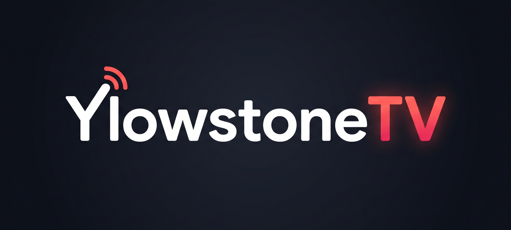

<p align="center">
  
</p>

<h1 align="center">YlowstoneTV</h1>

<p align="center">
  <strong>Zero-bloat native IPTV &amp; Xtream media engine for Android and Android TV.</strong>
</p>

<p align="center">
  
  
  
  
</p>

## Engineering Philosophy

YlowstoneTV is engineered around three strict constraints: **zero visual bloat**, **sub-second navigation across 175,000+ indexed entries**, and **hardened credential security**. No ads, no tracking telemetry, no cramped bottom navigation bars—just an AMOLED-first interface anchored by deterministic SQLite indexing, Android Keystore encryption, and a persistent Media3 ExoPlayer pipeline.

## Core Capabilities (`v2.4.7`)

- **Hardened Security & Dual-Role Access (Standard User vs. Full Admin):** Release builds compile with aggressive R8 obfuscation (`-optimizationpasses 5`, `-repackageclasses`), stripped runtime logs, `allowBackup="false"`, anti-debugger guards, and Android Keystore AES-256-GCM encryption for local playlist credentials. Standard User mode locks stream/playlist link inspection, hides protocol badges (`HLS`/`TS`) in the player status pill, and dynamically activates `FLAG_SECURE` anti-screenshot/anti-recording protection across Live TV, Movies, Series, Search, Playlists, and Video Players (while keeping Home and Settings capturable). Full Admin mode unlocks via salted SHA-256 verification with an optional default-playlist toggle.
- **AES-256-GCM Encrypted 1-File Backup & Restore (All Playlists + Settings + Favourites):** Exports every playlist, setting, and favourite into a single AES-256-GCM encrypted `.json` vault—unreadable in plain text yet seamlessly restorable across devices (with backward compatibility for legacy `.json` backups).
- **Last-Active Playlist Memory & Polished Settings Controls:** Reopening the app resumes directly into the last active playlist rather than resetting to alphabetical order. Settings features a borderless Boomerang loading overlay with an interactive Update Card popup for *Check Updates*, plus an exposed soft light-green *Clear Cache* button right above *Sign Out*.
- **Zero-Scroll Cinematic Home & Collapsing Scroll Headers (Phone & Android TV):** Pure `#000000` AMOLED single-screen dashboard featuring 3 custom matte WebP cover artworks (*TV*, *Movies*, *Series*) and genuine **InterDisplay** typography, paired with scroll-linked collapsing headers, borderless channel lists with active `#D4B88E` + red `• LIVE` indicators, and a floating mini-player bar.
- **Borderless 60fps Boomerang Loading Animations:** Hardware-accelerated Jetpack Compose `Canvas` morphing loaders (*Chroma Boomerang*, *Amber Boomerang*, *Aurora Boomerang*) floating cleanly over a dimmed backdrop with live preview inside Settings.
- **Smart Series Playback & Auto-Subtitle Pipeline:** Floating *Skip Intro* pill (*Off / Manual / Auto* with custom `MM:SS` & per-series duration memory), 15-second *Auto-Next Episode* countdown, release-tag candidate scoring for automatic Indonesian/preferred-language subtitles, per-series sync offset memory, and an accidental-tap-proof drag-only seekbar.
- **Gesture-Driven Portrait Player & UniversalStreamStabilizer v1.3:** Portrait split-screen supports interactive swipe-down-to-PiP drag animation and full in-portrait Audio/Subtitle controls, powered by anti-ghost TCP socket eviction, IPv4-first DNS + unified session CookieJar, Single-Stream Mutex with 400ms zapping debounce, clean Wi-Fi/Cellular network handoff, automatic 2-way `.m3u8 <-> .ts` failover, and configurable **Buffer Profiles**.
- **5 Unified Dynamic Theme Palettes & 12 Custom Icons:** 5 unified palettes (*System Auto*, *Dark AMOLED Noir*, *Light*, *Amber Dusk*, *Velvet Crimson*) that dynamically adapt all accents and collapsing header gradients across every screen, plus 12 switchable 3D launcher icons and 4-digit PIN category locks.

## System Architecture

```text
┌────────────────────────────────────┐      HTTPS / JSON      ┌──────────────────────────────┐
│   YlowstoneTV Android / TV App     │ ◄────────────────────► │   Edge API Backend (api/)    │
│  Kotlin · Jetpack Compose · SQLite │   /api/login           │   PIN Auth · Subtitle Proxy  │
│  Media3 ExoPlayer · OkHttp · Coil  │   /api/subtitles       └──────────────────────────────┘
└─────────────────┬──────────────────┘
                  │ Direct Stream / Xtream / M3U8 / Local .m3u
                  ▼
       User-Provided IPTV Sources          CI/CD: GitHub Actions → Signed Release APK (~6 MB)
```

## Supported Sources

| Source Type | Capabilities |
| :--- | :--- |
| **Xtream Codes API** | Indexed Live TV, VOD Movies, and Series with full season/episode fetching |
| **M3U / M3U8 Playlists** | Remote URL streaming parser or local `.m3u` file import via SAF |
| **Direct Stream URL** | Single-stream playback (`.m3u8`, `.mpd`, `.mp4`) with custom `User-Agent` |

## Build & Deployment

```bash
# Build signed release APK (JDK 17 + Android SDK 35)
./gradlew assembleRelease

# Output artifact
app/build/outputs/apk/release/app-release.apk
```

Prebuilt releases are published automatically via GitHub Actions on the [Releases](https://github.com/liveforever24/ylowstonetv/releases) page.

## Disclaimer

YlowstoneTV is strictly a pure media player application. It does **not** include, host, sell, or distribute any media streams, channels, or playlists. Users are solely responsible for supplying their own legally obtained playlists.

## Credits

Engineered by **ylowstone** · [github.com/liveforever24/ylowstonetv](https://github.com/liveforever24/ylowstonetv)
