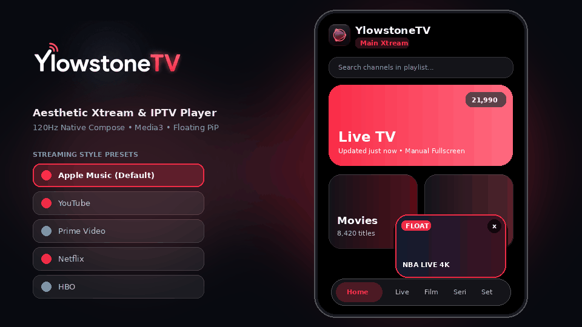
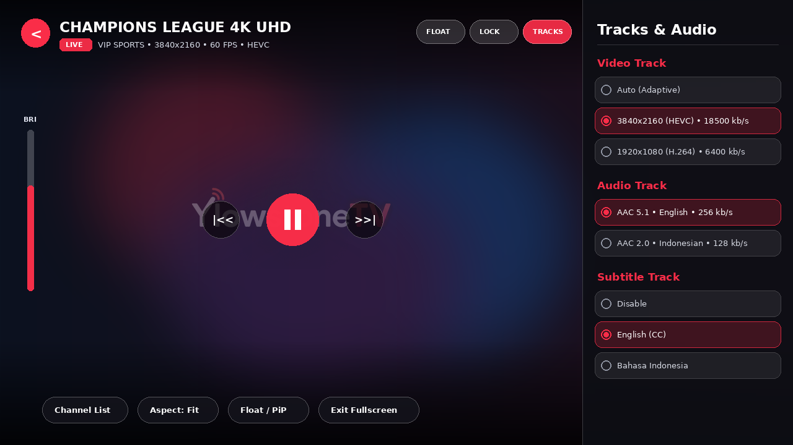

  

<h1 align="center">YlowstoneTV</h1>

  <strong>An aesthetic Xtream &amp; IPTV player, inspired by Apple Music.</strong>

  
  
  
  

**YlowstoneTV** is a lightweight, native media player for Android smartphones and Google/Android TV. Built from the ground up with Kotlin, Jetpack Compose, indexed local SQLite storage, and Media3 ExoPlayer, it delivers smooth high-refresh-rate browsing—even across playlists containing tens of thousands of channels—wrapped in a clean, distraction-free interface.

---

## Interface & Player Preview

### Animated UI, Style Presets & Floating Player

  

### Fullscreen Media3 Player & Track Controls

  

---

## Key Features

### Design & Streaming Style Presets
* **Apple Music-Inspired Aesthetics:** Minimalist layout featuring a floating translucent glass navigation bar, smooth animations, and native device typography.
* **5 Signature Style Presets:** Switch seamlessly between **Apple Music (Default)**, **YouTube**, **Prime Video**, **Netflix**, and **HBO** palettes—paired with **AMOLED Pure Black**, **Light**, or **System Default** themes.
* **Built for Large Playlists:** Indexed SQLite storage and lazy logo caching keep scrolling and searching instantaneous without memory bloat.

### Floating Player & Picture-in-Picture (PiP)
* **In-App Floating Mini-Player:** Return to Home, browse categories, or switch playlists while your channel continues playing in a sleek, draggable rounded-corner floating window.
* **System Picture-in-Picture:** Automatically transitions into a floating rounded PiP window when pressing Home or switching to other apps.

### Dual-Device Experience & Manual Fullscreen
* **Smartphone & Google/Android TV Modes:** Select your device profile on first launch or anytime in Settings, complete with D-Pad focus highlights and native Android TV launcher banner support.
* **Manual Fullscreen Orientation:** Browse and manage playlists comfortably in Portrait on mobile, and enter Landscape Fullscreen strictly when you tap the Fullscreen button.

### Playlist Management & Privacy
* **Multi-Playlist Support:** Save, switch, refresh, edit credentials, or inspect and copy playlist URLs without re-entering data from scratch.
* **Category PIN Lock:** Long-press any category to lock or unlock it with a 4-digit PIN. Locked categories are automatically excluded from search results.
* **Fast Discovery:** Instant in-playlist search, Master Search across all media types, Favorites, and Watch History.

### Playback Engine
* **Media3 ExoPlayer Core:** Hardware-accelerated playback for Live TV, Movies (VOD), and Series with episode browsing.
* **Full Player Controls:** Video, audio, and subtitle track selection, aspect ratio switching (*Fit, Fill, Zoom, 16:9*), screen lock, quick channel drawer, optional brightness/volume swipe gestures, and external player handoff.

### Utility
* **Bilingual Interface:** Available in **English (US)** and **Bahasa Indonesia**.
* **In-App Updates:** Check, download, and install new releases directly from GitHub Releases inside the app.

---

## Supported Sources

YlowstoneTV focuses on three reliable, standard media loaders:
1. **Xtream Codes API** — Automatic separation into Live TV, Movies, and Series.
2. **M3U / M3U8 Playlists** — Load from a remote URL or a local `.m3u` file.
3. **Direct Stream URL** — Play single streams (`.m3u8`, `.mpd`, `.mp4`) with optional custom `User-Agent` headers.

---

## Installation

1. Open the [Releases](https://github.com/liveforever24/ylowstonetv/releases) page.
2. Download the latest `YlowstoneTV-vX.X.X-by-ylowstone.apk` file.
3. Install the APK on your Android smartphone (Android 10+) or Google/Android TV.
4. Future updates can be installed directly via **Settings → Check for App Updates**.

---

## Build from Source

Requires **JDK 17** and **Android SDK API 35**:

    git clone https://github.com/liveforever24/ylowstonetv.git
    cd ylowstonetv
    gradle assembleRelease

---

## Disclaimer

YlowstoneTV is strictly a media player application. It does **not** include, host, provide, or distribute any media content, streams, or playlists. Users are solely responsible for providing their own legally obtained playlists and streaming sources.

---

## Credits

Crafted by **ylowstone** · [github.com/liveforever24/ylowstonetv](https://github.com/liveforever24/ylowstonetv)
